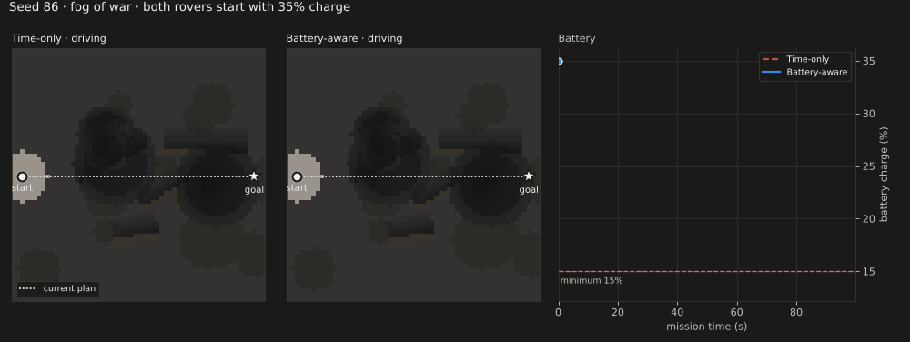
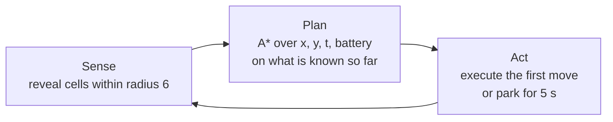
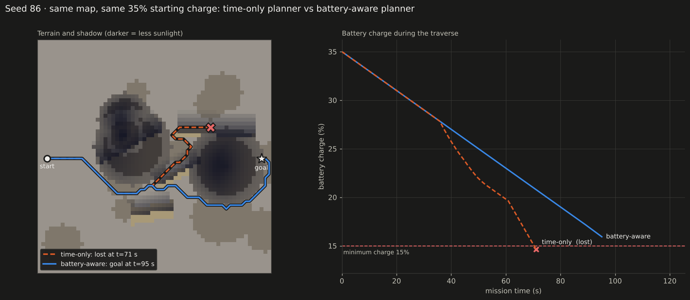
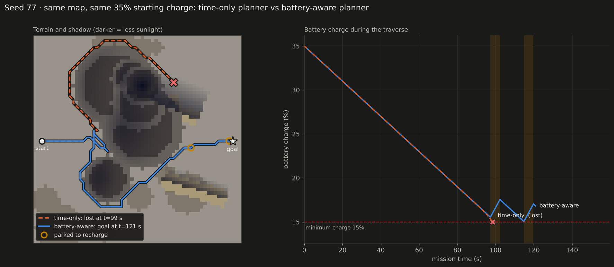
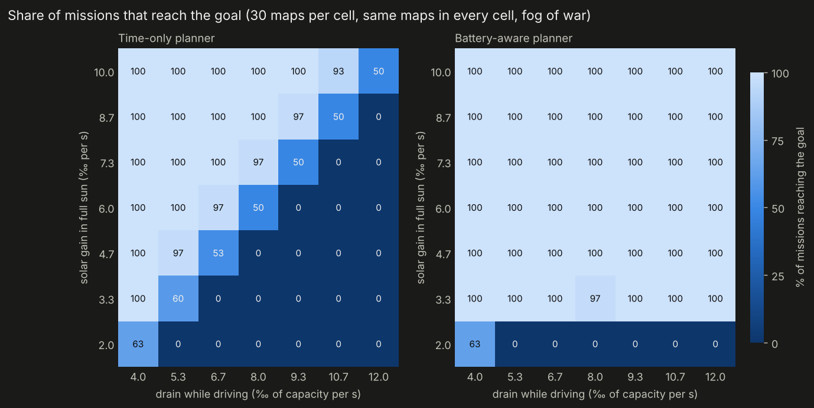

# Lunar Rover Planner

**Battery- and shadow-aware path planning for a solar-powered lunar rover exploring unknown terrain.**



A rover has to cross a 60×60 grid of lunar terrain as fast as possible. Craters and dunes cast shadows that move with the sun, driving drains the battery faster than full sunlight recharges it, and the rover can only see 6 cells around itself. If its charge drops below 15%, the mission is lost.

This repo plans that traverse with a time-dependent A* search over position, time and battery, wrapped in a sense-plan-act loop that replans as new terrain comes into view.

**On 200 random maps:**
- A planner that only minimizes time loses the rover on **90 of 200** maps. The battery-aware planner reaches the goal on **all 200**.
- When the battery isn't the limiting factor, the battery-aware planner is just as fast: it matched the baseline's time on 103 of the 110 maps where the baseline survived.
- Each replan takes **0.4 ms** on average in this benchmark (C++17, single thread).

---

## The problem

| | |
|---|---|
| **Terrain** | Procedurally generated craters, dunes and rocky patches. Flat ground costs ~1 s per cell, rocky ground 1.3–2.2 s, and craters and dunes 5–10× flat. |
| **Lighting** | Crater rims shade their floors and dunes cast directional shadows; both move as the sun angle advances. |
| **Energy** | Driving costs 0.8% of capacity per second. Sunlight returns up to 0.6%/s, scaled by the light level. Parked, the rover uses 0.2%/s, so **parking in sunlight is the only way to gain charge**. |
| **Sensing** | The rover observes terrain within a 6-cell radius. Everything beyond that is unknown. |
| **Goal** | Reach the far side as fast as possible without dropping below 15% charge. |

## How it works



**1. Time-dependent A* over (x, y, time, battery).** The search minimizes arrival time, subject to charge never dropping below the minimum. Light depends on *when* the rover reaches a cell, so the energy cost of each move depends on the time of arrival. The heuristic is octile distance times the cheapest possible cell cost. It never overestimates, so the search returns the fastest feasible plan, up to the approximation described under Limitations.

**2. Pareto sets instead of a plain closed list.** A standard closed list keeps only the fastest arrival at each cell. With a battery constraint, that throws away a slower partial route that arrives with *more charge*, and that route may be the only one that reaches the goal. Each cell therefore keeps every non-dominated `(time, battery)` label: one label replaces another only if it arrives no later **and** with no less charge. Charge differences under 0.5% are treated as ties, which keeps the sets small. The plan's charge is still tracked exactly, so every plan the search returns is feasible.

**3. A park-and-recharge action.** At any cell the rover can wait 5 s. The search only generates this action when it gains net charge (`light × gain > idle drain`). The Pareto sets keep waiting in check: a longer wait survives only if it buys more charge than the shorter wait it competes with.

**4. Planning under fog of war.** The rover plans on its *belief* about the map:
- **Unknown terrain is assumed to be cheap** (1 s per cell). This standard free-space assumption makes the rover explore toward the goal.
- **Lighting is assumed known in advance.** Lunar polar missions such as VIPER plan traverses using illumination predicted from orbital elevation maps and the sun's ephemeris. What the rover has to discover is how hard the ground is to cross.
- **After every step, the rover senses, updates its belief, replans from its current state, and executes only the first action.** The cell it is about to enter is always one it has already seen, which a unit test checks.

## Results

### Two examples

**Route choice (seed 86).** Both rovers head east. The time-only rover turns north toward a gap that looks short, drives into a dune's shadow, and runs out of charge at t = 71 s. The battery-aware rover stays south in full sun and arrives at t = 95 s with 16% left, without stopping once.



**Parking to recharge (seed 77).** Both rovers first head north. After a few steps, the battery-aware rover's replanned route turns back and goes around to the south, where it parks twice in sunlight to stay above 15%. The short dead-end near the start is that replan.



### Benchmark: 200 random maps

Every planner runs on the same 200 maps with the default parameters (`python scripts/experiments.py`):

| Planner | Reached goal | Median time (s) | Mean recharge stops | Mean time per replan |
|---|---|---|---|---|
| Time-only (baseline) | 110/200 (55%) | 74 | 0.0 | 0.12 ms |
| Battery-aware, parking disabled | 111/200 (56%) | 74 | 0.0 | 0.28 ms |
| **Battery-aware** | **200/200 (100%)** | 88 | 1.6 | 0.37 ms |
| Battery-aware, full map known | 200/200 (100%) | 78 | 0.2 | 9.5 ms (one plan) |

Some patterns from these runs:
- **Under fog of war, route choice alone is rarely enough.** Without parking, the battery-aware planner saves only 3 of the 90 doomed missions, because by the time the rover sees a shadow it is often too late to go around. Seed 86 above is one of those 3. Parking is what saves the other 87.
- **Seeing the map early replaces parking with route choice.** With the full map known, the rover averages 0.2 recharge stops per mission instead of 1.6, because it can pick a sunlit route from the start.
- **Exploring costs about 8%.** The median mission under fog of war took 8% longer than with the full map known.

### Parameter sweep

Same 30 maps in every cell, 7×7 grid of drain and solar gain (`python scripts/sweep.py`):



The time-only planner's success rate falls to zero once driving costs more than full sunlight returns. The battery-aware planner succeeds on almost every map, as long as parking in full sun gains charge at all. In the bottom row, solar gain equals the parked drain (0.2%/s), so parking gains nothing and both planners fail the same way.

## Limitations

These are the parts I would change before trusting this on a real rover:

- **Dominance is approximate when lighting changes over time.** Arriving earlier with more charge is *usually* better. But if a cell is about to come out of shadow, a later arrival could do better afterward. Combined with the 0.5% tie tolerance, the plans are always feasible but only near-optimal.
- **There is no mission deadline.** With unlimited parking, almost any map is eventually feasible, which is why the battery-aware success rate is near 100%. A real mission has a lunar-day or communication-window deadline. The planner already has a `time_limit_sec` setting for this. Turning it on would make the sweep more interesting.
- **Plans run right down to the 15% floor.** A time-optimal plan uses all the margin it is given. A real rover would plan with a reserve, plus uncertainty in drain and terrain cost.
- **The physics is simplified.** Shadows come from geometric crater and dune models, not ray tracing on an elevation map. Each move's energy uses the light level on arrival. The model has no vehicle dynamics and no wheel slip.
- **The planner replans from scratch every step.** At 0.4 ms per replan that's fine on a 60×60 grid. At real map scales, an incremental planner like D* Lite would be the right tool.

## Next steps

- Run on real terrain: a LOLA elevation map of a south-polar site, with illumination computed from the sun's actual position.
- Make traverse cost depend on slope and wheel slip (terramechanics) instead of fixed per-type costs.
- Add a mission deadline and plan with a battery reserve that grows with uncertainty about unseen terrain.
- Replace from-scratch replanning with D* Lite.

## Build and run

Requires CMake ≥ 3.14 and a C++17 compiler. The plotting scripts need Python 3 with numpy, matplotlib and pillow.

```bash
cmake -S . -B build -DCMAKE_BUILD_TYPE=Release
cmake --build build -j
ctest --test-dir build --output-on-failure     # unit tests

mkdir -p output
./build/lunar_rover                     # battery-aware, fog of war, demo map (seed 86)
./build/lunar_rover --blind --output output/blind.json   # time-only baseline

pip install -r requirements.txt
python scripts/visualize.py compare output/blind.json output/plan.json
python scripts/visualize.py animate-compare output/blind.json output/plan.json
```

Useful flags (`./build/lunar_rover --help` lists them all):

| Flag | Meaning |
|---|---|
| `--seed N` | terrain seed |
| `--blind` | time-only baseline that ignores the battery |
| `--full-map` | rover knows the whole map (no fog of war) |
| `--no-wait` | disable parking |
| `--battery-start F`, `--drain F`, `--gain F`, `--idle-drain F` | energy model |
| `--obs-radius N` | sensing radius in cells |
| `--summary --no-output` | print a one-line JSON result (used by the experiment scripts) |

`scripts/make_figures.sh` regenerates every figure and table in this README. It takes about 7 minutes on two cores, mostly for the sweep.

## Repository layout

```
include/        map.h, planner.h, mission.h
src/
  map.cpp       terrain generation and shadow model
  planner.cpp   time-dependent A* with Pareto (time, battery) labels
  mission.cpp   sense-plan-act loop under fog of war
  main.cpp      command-line interface and JSON output
tests/          unit tests (run with ctest)
scripts/        visualize.py, experiments.py, sweep.py, make_figures.sh
results/        benchmark tables (CSV and Markdown)
docs/media/     figures used in this README
```

## Background

This started as my final project for CMU 16-350 (Robotics Planning). I have since rebuilt the planner with real fog-of-war replanning, a battery-feasible search (Pareto labels and recharge stops), unit tests, and a benchmark across 200 maps.

Sebastian Martinez · B.S. Physics, minor in Robotics, Carnegie Mellon University
